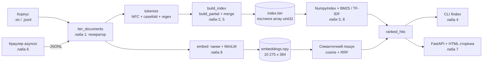
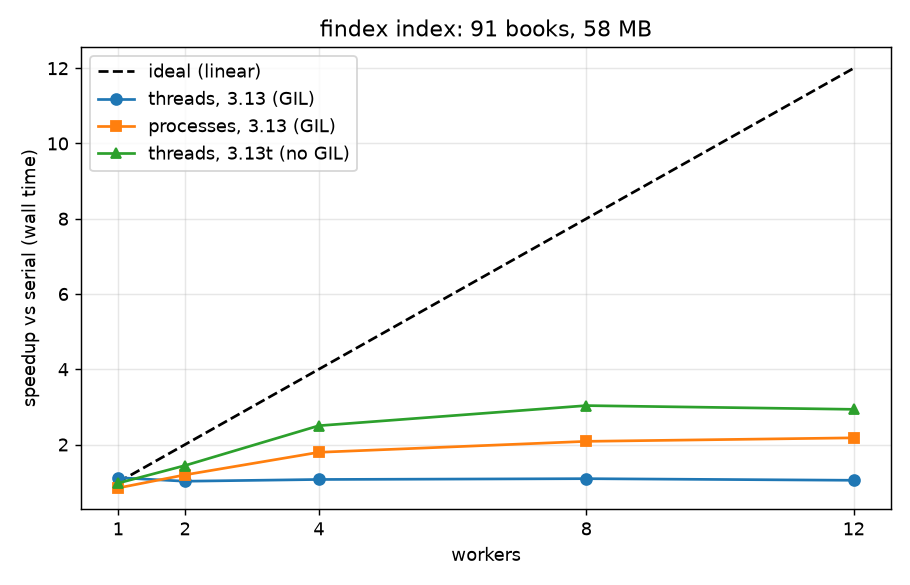

# findex

[](https://github.com/IIVKKKA/findex/actions/workflows/ci.yml)

**findex — пошукова система на чистому Python: ліниве читання корпусу → інвертований індекс → BM25 / семантичний / гібридний пошук → CLI, API та веб-сторінка.**
Побудована за вісім лабораторних курсу Python; кожна лаба — окремий крок і окремий тег (`lab-01` … `lab-08`, реліз `v1.0.0`).

| | |
|---|---|
| **Жива адреса** | ⚠️ *не розгорнуто:* потрібен ваш акаунт Render/Fly.io/Railway. Конфіг готовий (`Dockerfile`, `render.yaml`), кроки — у розділі «Деплой» [docs/labs.md](docs/labs.md) |
| **GIF пошуку / відео 2–3 хв** | ⚠️ *не записано:* їх має зняти автор (екран комп'ютера). Інструкція в кінці цього файлу |
| **Три головні числа** | **58 МБ** корпус (91 книга, 9.75 млн токенів) · **p95 = 1.1 с** для пошуку зі сніпетами при 20 одночасних з'єднаннях (4 воркери, локально) · **203×** — найбільше прискорення (NumPy-скорер проти скорера лаби 3 на частому слові `the`) |

## Спробувати за 2 хвилини

```bash
uv sync
uv run python scripts/download_corpus.py                        # ~58 МБ Project Gutenberg -> data/gutenberg/
uv run findex index data/gutenberg --out index.bin --positions  # ~6 с на 12 ядрах (процеси)
uv run findex search index.bin 'whale AND (harpoon OR ship) NOT "moby dick"' -k 5
uv run findex serve --index index.bin                           # http://127.0.0.1:8000  (API: /api/docs)

# необов'язково: семантичний і гібридний пошук (потрібні ембединги, ~8 хв на CPU)
uv run findex embed data/gutenberg -o embeddings.npy --max-chunks-per-doc 120
uv run findex search index.bin "giant sea creature hunted by sailors" --mode hybrid --embeddings embeddings.npy
```

Мова запитів: `a b` (AND), `OR`, `NOT`, дужки, `"точна фраза"` (потрібен індекс з `--positions`).

## Шлях даних



## Усі вимірювання в одному місці

Машина: AMD Ryzen 5 5600X (6 ядер / 12 потоків), 32 ГБ, Windows 11, Python 3.13. Корпус: 91 книга Project Gutenberg, 58 МБ.
Деталі, пояснення й сирі дані кожної лаби — у [docs/labs.md](docs/labs.md) і [docs/data/](docs/data/).

### Лаба 1 — ліниво проти жадібно (повний корпус, `tracemalloc`)

| Версія | Документів | Пік пам'яті | Час |
|---|---|---|---|
| eager (списки) | 91 | 604.0 МіБ | 41.9 с |
| lazy (генератори) | 91 | 88.8 МіБ | 46.2 с |

### Лаба 2 — індекс: пам'ять, формати, merge проти set

| Представлення постингів | Пік пам'яті (build) | Файл (pickle) | Байтів на постинг (довгі списки) |
|---|---|---|---|
| `@dataclass` | 166.3 МіБ | 23.58 МіБ | 128.7 |
| `slots=True` | 131.8 МіБ | 18.40 МіБ | 88.7 |
| `array('I')` | 141.2 МіБ | 30.04 МіБ | **8.4** |

Бінарний формат (array + JSON-заголовок): 13.40 МіБ, save 0.62 с, load 2.65 с (pickle: 4.29 с / 8.37 с). Позиції збільшують пік пам'яті у 3.8×.
`merge` швидший за `set` на списках довжини 1 і на дуже великих; `set` швидший на коротких (91×91).

### Лаба 3 — рейтинг (10 розмічених запитів, precision@5)

| | TF-IDF | BM25 |
|---|---|---|
| Середнє P@5 | 0.46 | 0.48 |

Три перевірки BM25: рідкий терм `mersenne` — 8.49 проти 0.014 у `the`; saturation: tf=20 додає лише +0.30; короткий документ — 3.56 проти 0.43 у найдовшого.

### Лаба 4 — якість

**310 тестів** (150 було на момент лаби 4), `pyright --strict`: 0 помилок, `ruff` чистий, покриття 88 % (гілки), CI на кожен push, реліз `v0.4.0` із wheel.

### Лаба 5 — паралельна індексація (час побудови, 3 запуски, медіана)

| Інтерпретатор | Executor | Воркерів | Wall, с | CPU, с | Прискорення |
|---|---|---|---|---|---|
| 3.13 (GIL) | serial | 1 | 12.33 | 12.05 | 1.00× |
| 3.13 (GIL) | threads | 12 | 11.75 | 11.67 | 1.05× |
| 3.13 (GIL) | processes | 12 | 5.66 | 20.72 | 2.18× |
| 3.13t (без GIL) | threads | 8 | 4.06 | 18.88 | **3.03×** |



Аналіз GIL і гонки за даними (на 3.13t `Counter` втрачає 79 % оновлень без блокування): [docs/gil.md](docs/gil.md).

### Лаба 6 — асинхронний краулер (200 сторінок, локальне дзеркало, 50 мс на запит)

| Concurrency | Ліміт на хост | Wall, с | Сторінок/с | Пік RSS |
|---|---|---|---|---|
| 1 | 1 | 11.34 | 17.6 | 46 МіБ |
| 5 | 5 | 3.00 | 66.6 | 45 МіБ |
| 20 | 20 | **1.42** | **140.6** | 48 МіБ |
| 20 | 2 | 6.20 | 32.3 | 46 МіБ |

### Лаба 7 — HTTP-сервіс (oha, 20 з'єднань, 10 с, запит із трьох термів + 10 сніпетів)

| Налаштування | Запитів/с | p50, мс | p95, мс | p99, мс |
|---|---|---|---|---|
| **до лаби 8:** 1 воркер, `def` | 3 | 6 547 | 9 931 | 9 931 |
| **до лаби 8:** 4 воркери, `def` | 7 | 2 868 | 7 193 | 7 398 |
| 1 воркер, `async def` | 19 | 1 116 | 1 734 | 2 517 |
| 1 воркер, `def` | 22 | 948 | 1 646 | 1 845 |
| 4 воркери, `def` *(медіана 3 прогонів; розкид 23–59 запитів/с)* | 38 | 478 | 1 115 | 1 211 |
| розгорнутий сервіс | — | — | — | — *(не розгорнуто)* |

### Лаба 8 — профілювання й прискорення

Спершу виміряно, куди йде час ([docs/profiling.md](docs/profiling.md), flame graph: [пошук](docs/flame_search.svg), [індексація](docs/flame_build.svg)):

| Місце | Було | Стало | Прискорення | Що зроблено |
|---|---|---|---|---|
| Запит із трьох термів + 10 сніпетів | 474 мс | **37 мс** | **12.7×** | сніпет: `str.find` по шматках 64 КБ замість regex по всій книзі (регулярка йшла ~25 МБ/с), ранній вихід, шукати лише терми, що є в документі, ліміт сканування 400 К символів |
| Індексація (послідовно, 58 МБ) | 12.33 с | **8.95 с** | **1.38×** | апострофи нормалізуються один раз на текст, а не на кожен із 10 млн токенів; `Counter(iterable)` рахує в C |

Скорер: лаба 3 (Python, об'єкти `Posting`) проти NumPy (`int32` масиви, вирази над масивами, `np.argpartition`); порядок результатів збігається з лабою 3 (тест, у т. ч. при однакових балах):

| Корпус | Запит | Лаба 3, мс | NumPy, мс | Прискорення |
|---|---|---|---|---|
| реальний, 91 док. | `the` | 9.660 | 0.048 | **203×** |
| реальний, 91 док. | `mersenne` | 0.016 | 0.025 | 0.6× *(NumPy повільніший)* |
| реальний, 91 док. | `whale OR harpoon OR ship` | 0.213 | 0.080 | 2.7× |
| синтетичний, 100 000 док. | `common` | 90.0 | 2.94 | 30.6× |
| синтетичний, 100 000 док. | `rare` | 0.065 | 0.066 | 1.0× |
| синтетичний, 100 000 док. | `common OR mid OR rare` | 98.0 | 3.88 | 25.3× |

Де виграш малий: список постингів із 1 документа — накладні витрати виклику NumPy (створення масивів, `argpartition`, `lexsort`) більші за саму роботу, а на 91 документі
ранжування й без того займає 0.2 мс; NumPy виграє, коли списки довгі — «частий» терм (500 000 позицій у `the` або 50 000 постингів).

Семантичний пошук (all-MiniLM-L6-v2 через `fastembed`, 10 275 фрагментів по ~900 символів, до 120 на книгу; запит — **2.8 мс**: ембединг запиту + добуток матриці 10 275×384 + максимум по фрагментах кожного документа).
precision@5 на 15 розмічених запитах (мітки поставлено до запуску):

| Режим | 10 запитів лаби 3 | 5 перефразованих (без слів із книги) | Усі 15 |
|---|---|---|---|
| BM25 (як набрано; перефрази — неявне AND) | 0.48 | 0.16 | 0.37 |
| Семантичний | 0.48 | **0.40** | **0.45** |
| Гібрид (BM25 на OR-мішку слів + семантика, RRF) | 0.48 | 0.28 | 0.41 |

Що видно: на запитах із ключовими словами всі три режими однакові (0.48): слова книги й так знаходять її. На перефразах семантичний пошук знаходить книги
за змістом («the fallen angel rebels against heaven» → «Paradise Lost» першим), де BM25 із неявним AND майже порожній (0.16). Гібрид посередині: BM25-половина лишається слабкою
на перефразах і тягне результат вниз; на 15 запитах із розмітками одного автора різницю 0.45 проти 0.41 не варто вважати доведеною. Повна таблиця: [docs/data/eval8.md](docs/data/eval8.md).

## Обмеження (чесно)

* **Маленький корпус:** 91 книга, 58 МБ, переважно англійська. Висновки про «швидко» — для цього розміру; масштаб 10× не перевірявся (крім синтетичного тесту NumPy-скорера).
* **Не розгорнуто:** живої адреси, p95 із публічного сервісу, GIF і відео немає. `Dockerfile` ніколи не збирався на цій машині (немає Docker); перевірено лише `findex serve` і тести.
* **Оцінки якості хиткі:** 15 запитів, мітки поставив один автор за пам'яттю про книги; різниці 0.02–0.04 — шум.
* **Семантика наближена:** ембедингові фрагменти — рівномірна вибірка до 120 на книгу (ембединг ~25–40 фрагментів/с на CPU), тому можна пропустити змістовний уривок; модель — англійська, у корпусі є кілька неанглійських текстів.
* **Сніпети:** сканування обмежене 400 К символів на документ — кращий збіг далі в довгій книзі не знаходиться. Індекс незмінний (без дозавантаження документів), без стемінгу й стоп-слів.
* **Вимірювання:** одна машина (Windows), навантаження oha й сервер на ній самій; прогони чотирьох воркерів дуже мінливі (23–59 запитів/с), на 4 воркерах uvicorn на Windows у логах трапляється помилка `listen` (`WinError 10022`).
* **Безпека:** `pickle` небезпечний для чужих файлів (є бінарний формат); веб-сервіс без автентифікації й обмеження частоти запитів.

## Структура репозиторію

```
src/findex/   corpus tokenize index store parallel scoring npsearch ranking semantic modes query snippets crawler mirror cli web/
tests/        310 тестів: pytest, Hypothesis, CliRunner, TestClient, MockTransport, pytest-benchmark
scripts/      замірювальні скрипти кожної лаби (bench_lab5/6/7/8, eval_lab3/8, profile_*)
docs/         labs.md (розбір по лабах), profiling.md, gil.md, flame_*.svg, data/ (сирі виміри)
```

## Як зняти GIF і відео (їх має зробити автор)

* **GIF** (5–10 с): `findex serve`, у браузері запит `giant sea creature hunted by sailors` у режимі Hybrid → ScreenToGif/LICEcap → `docs/demo.gif`, вставити під заголовок.
* **Відео 2–3 хв:** сценарій — шлях даних (діаграма) → `findex index` → пошук у CLI → веб-сторінка → одна цифра з профілювання (474 → 37 мс) → один баг, на якому щось стало зрозуміло (квадратичний пошук вікна сніпета, що виявило навантажувальне тестування).
